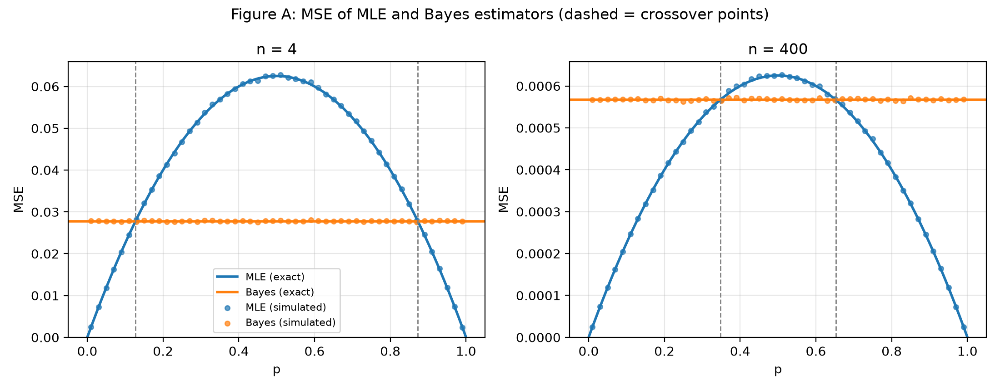
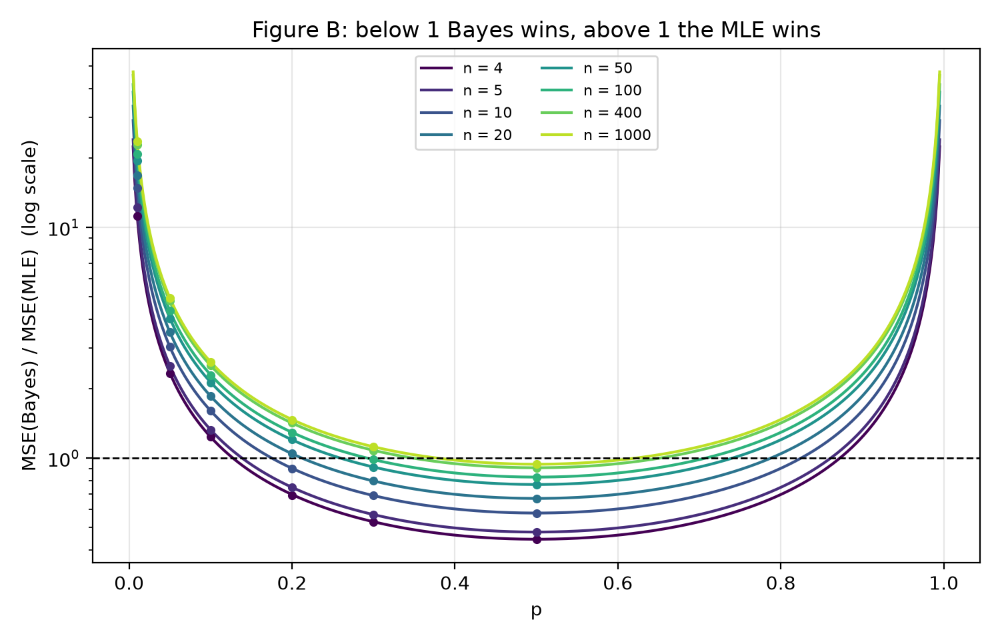
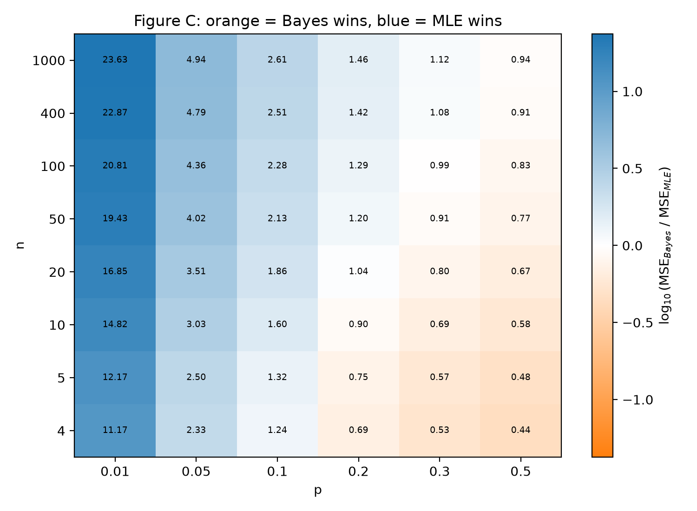
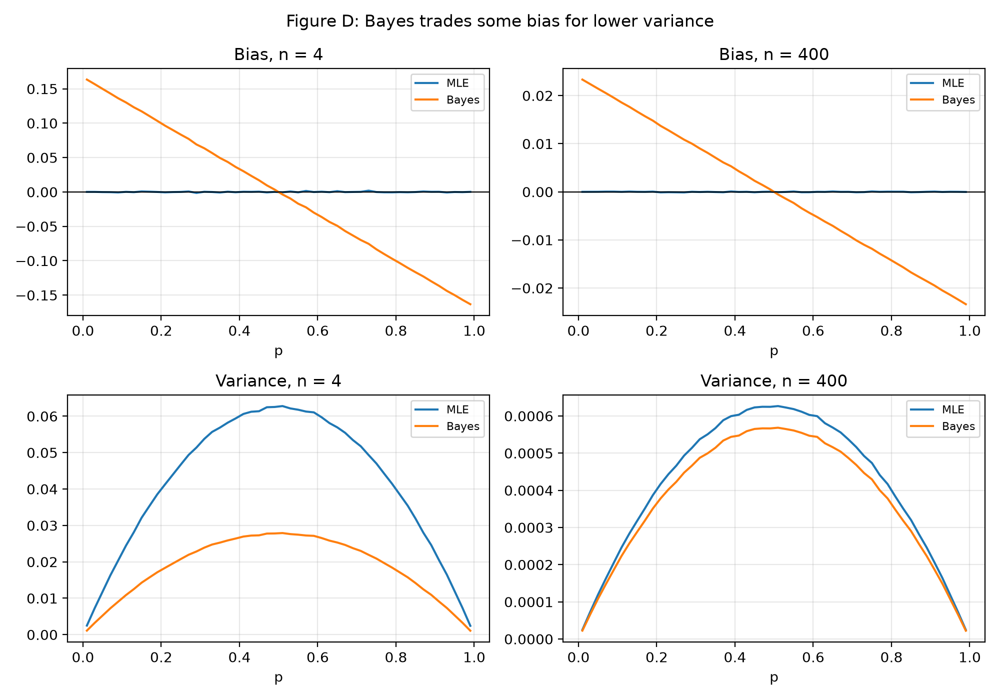
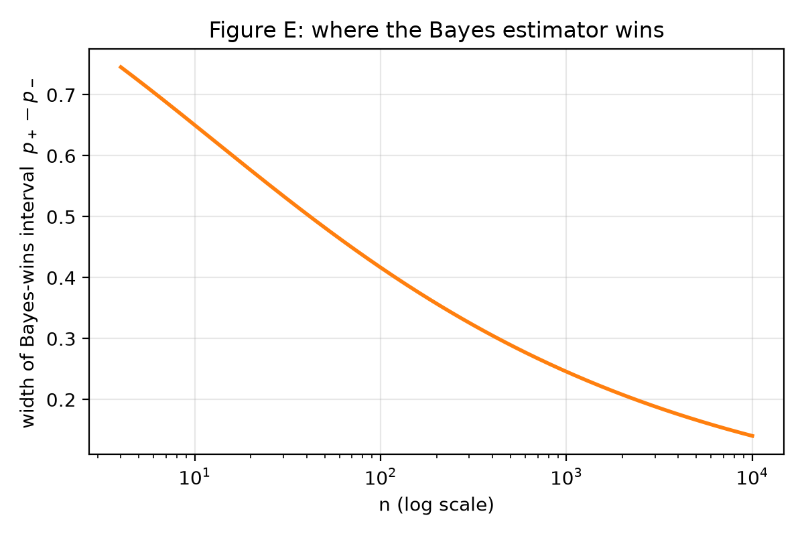

# Bayes vs MLE: comparing two estimators of a binomial proportion

Monte Carlo study for project **202633**, reproducing Example 7.3.5 of Casella & Berger, *Statistical Inference* (2nd ed.).

We observe X₁, …, Xₙ iid Bernoulli(p) and compare two estimators of p by their mean squared error (MSE):

| Estimator | Formula |
| --- | --- |
| MLE (sample proportion) | $\hat p = S/n$ |
| Bayes (posterior mean under a Beta(√(n/4), √(n/4)) prior) | $\hat p_B = \dfrac{S + \sqrt{n/4}}{n + \sqrt{n}}$ |

where $S = \sum_i X_i \sim \text{Binomial}(n, p)$.

The textbook gives both MSEs in closed form, which lets us check the simulation against theory:

$$\text{MSE}(\hat p) = \frac{p(1-p)}{n}, \qquad \text{MSE}(\hat p_B) = \frac{n}{4\,(n+\sqrt n)^2}$$

The first is a parabola in p. The second does not depend on p, which is the reason for the choice α = β = √(n/4).

**Main result: neither estimator dominates the other.** Bayes is better for small n and for p near 0.5. The MLE is better for large n and for p near 0 or 1. See [CONCLUSION.md](CONCLUSION.md) for the full discussion.

## Repository contents

| File | Purpose |
| --- | --- |
| `config.py` | Shared settings: grids of p and n, number of replications `M`, random `SEED` |
| `estimators.py` | The two estimators, their exact MSEs, and the exact `crossover(n)` points |
| `simulate.py` | Monte Carlo engine: bias, variance and MSE of both estimators on the full grid. Writes `results.csv` |
| `validate.py` | Compares simulated MSE with the exact formulas and runs sanity checks. Writes `validation.csv` |
| `make_figures.py` | Figures A to D. Also creates `results_dense.csv` (dense p grid for n = 4 and n = 400) if it is missing |
| `crossover_check.py` | Checks the exact crossover points against the simulation and draws Figure E |
| `results.csv` | Simulation output (48 rows: 6 values of p × 8 values of n) |
| `results_dense.csv` | Simulation output on a dense p grid, used by Figures A and D |
| `validation.csv` | Simulated vs exact MSE with relative errors |
| `Conclusion.md` | The answer to the project's question and what is concluded |
| `README.md` | A README file for better guidance |
| `figures/` | Figures A to E as PNG files |


## How to run

Python 3 with the packages in `requirements.txt`:

```bash
pip install -r requirements.txt

python simulate.py          # 1. Monte Carlo simulation  -> results.csv
python validate.py          # 2. validation vs exact MSE -> validation.csv
python make_figures.py      # 3. figures A-D             -> figures/
python crossover_check.py   # 4. crossover check + Figure E -> figures/figE_width.png
```

Run the steps in this order, from the project folder, because each step reads the files written by the previous one. Everything is seeded (`SEED = 42` in `config.py`), so rerunning gives identical numbers. The full pipeline takes a few seconds.

## Design of the experiment

- **Grid:** p ∈ {0.01, 0.05, 0.1, 0.2, 0.3, 0.5} and n ∈ {4, 5, 10, 20, 50, 100, 400, 1000}. The values n = 4 and n = 400 are the ones used in the textbook's Figure 7.3.1.
- **Replications:** M = 100,000 per (p, n) pair.
- **Shortcut:** both estimators depend on the data only through S, so we draw S directly from Binomial(n, p) instead of generating n separate Bernoulli draws.
- **Quantities estimated:** bias, variance and MSE of each estimator, with MSE = variance + bias².
- Only the symmetric half p ≤ 0.5 is simulated on the main grid, since both MSEs are symmetric around p = 0.5.

## Results at a glance

**Validation.** Across all 48 (p, n) pairs, the simulated MSE is within 1.9% of the exact value for the MLE and within 0.9% for the Bayes estimator (0 of 48 rows above 2%). The identity MSE = variance + bias² holds to about 1e-16.

**Figure A** reproduces the textbook's Figure 7.3.1: the MLE's MSE is a parabola, the Bayes MSE is flat, and the simulated points lie on the exact curves. Dashed lines mark the exact crossover points.



**Figure B** shows the ratio MSE(Bayes) / MSE(MLE) against p, one curve per n. Below 1 Bayes wins, above 1 the MLE wins.



**Figure C** shows the same ratio for every simulated (p, n) cell. Orange cells are won by Bayes and blue cells by the MLE. Both colours appear, which is the visual answer to the question "does one estimator dominate?".



**Figure D** shows the bias and variance of each estimator. The Bayes estimator accepts some bias in exchange for lower variance.



**Figure E** shows the width of the interval of p where Bayes wins, as a function of n. It shrinks, but slowly.



## Reference

Casella, G. and Berger, R. L. (2002). *Statistical Inference*, 2nd ed., Example 7.3.5 and Example 7.2.14.
